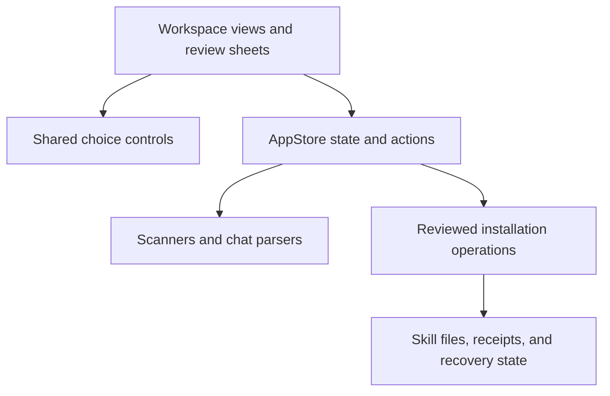

# Quartermaster design

Quartermaster helps you find skill sources, make skills available to coding agents, and review recorded use. Its design keeps these activities distinct because storing a skill, installing it, and using it answer different questions.

This document explains the design decisions behind the current app and the six-perspective target clarified on 2026-10-10. Sections whose headings start with **Target** describe that contract, not behavior every screen already implements. The other sections describe the current app. [UI.md](UI.md) separates the target presentation from the current interface. [README.md](README.md) covers setup and user workflows.

## Target: six perspectives on the same skills

The product has six perspectives. Each perspective answers a different question and gives a skill different emphasis and actions.

| Perspective | Question | Information that leads | Main action |
| --- | --- | --- | --- |
| Dashboard | What needs my attention? | Recorded use within a stated scope, differing copies, missing sources, and review findings. | Open the relevant review or skill. |
| Discovery | What can I bring into my Library? | Repository or folder origin, version, preview contents, Library import state, and scripts or flagged commands. | Add to Library, or review an imported source's update. |
| Storage | Where is the skill stored or made available? | Library sources, Global entries, project copies, inherited availability, paths, and ownership. | Manage the selected source or installation scope. |
| AI tools | What can this agent read in this workspace? | The selected agent's readers, supplying folders, available skills, conflicts, and recorded use. | Add to this agent or review removal from its supplying entry. |
| Skillsets | What belongs in this reusable collection? | Name, membership, preferred sources, assignments, applied snapshots, and pending changes. | Rename or edit membership, or preview application to a destination. |
| Ideas | What new skill would help with repeated work? | Supporting requests, draft contents, saved-source identity, and actual availability after saving. | Draft, edit, or save the proposed skill. |

Storage contains Library, Global, and Projects. These are subviews of one perspective rather than three additional perspectives. The AI tools perspective starts with an agent and then selects Global or a registered project. Storage starts with a location and then filters by agent.

Both routes use the same installation, availability, and assignment records. Switching perspectives changes presentation and context. It does not create another copy or another ownership model.

AI tools is not a filtered copy of Projects. Projects with an Agent filter answers which skills are in or inherited by a folder. AI tools answers how one agent reads them: which configured roots supply each skill, whether a project and a Global entry both supply it, and which other readers share that entry.

Chat activity is a recorded-use view within the Dashboard perspective. Plugin inspection belongs with the relevant AI tool. Suggestions and Similar skills belong under Ideas. The current sidebar still exposes these destinations separately; grouping them under the six perspectives is target navigation.

## Target: skill presentation depends on perspective

A skill keeps its identity, name, description, and source relationships across views. Its row and detail pane lead with the information needed for the current question. They do not repeat every section at equal weight.

The detail order is identity, perspective-specific facts, status, primary action, and supporting details. Locations, full contents, and other perspectives remain reachable. Cross-perspective navigation preserves the skill and carries an explicit workspace or agent when relevant.

Status badges describe facts. Action chips are buttons with verbs such as **Add to Library**, **Apply to project…**, or **Remove from Codex…**. An availability badge never doubles as an undisclosed installation toggle.

Agent badges follow [every applicable agent stays visible](#every-applicable-agent-stays-visible). The selected agent can receive emphasis.

Badges retain their meaning across perspectives. **In Library** means source storage, **Available** means readable by an agent, **Assigned** means a collection assignment, and **No recorded use** means missing chat evidence in the stated scope. None substitutes for another.

Primary actions follow scope. Library removal concerns a source. Global removal concerns a reviewed home-level entry. Project removal concerns a project target. Skillset removal concerns membership. Removing an idea concerns the saved idea record, not an installed skill.

The intended row information, badges, and action rules are specified in [the perspective presentation contract](UI.md#target-skill-presentation-by-perspective).

### List information versus detail information

The list helps the user recognize and compare items. Its shared frame is name, short description, one perspective fact line, status, and reader badges. Scope shared by the list belongs in its header. Full paths, copy selection, receipts, assignment snapshots, contents, and evidence belong in details. An urgent finding appears near the name without replacing it. Selecting a row never applies a change.

The detail pane explains the selected source and scope before an action. Inspection is the default for existing entries; removal is secondary and reviewed. Similar pairs lead to comparison before proposing a merge. Suggestions have their own identity and supporting request evidence until a saved skill resolves. These distinctions keep a collection member, an idea, a physical entry, and a repository preview from looking like interchangeable installations.

Reader badges must say what they describe: a selected source, physical entries in a location, or an explicitly name-wide union. Suggestion agents are evidence, and collection destinations are assignments. Neither is an applied-tool claim. Source-qualified selection is required for consequential actions because current inventories group skills by name. Existing grouped use counts cannot establish which same-name source ran.

Preferred-source choice is shared across Quartermaster for a skill identity. It affects future addition/application plans; it does not silently replace existing installations or applied project snapshots. Repository freshness requires a successful source check and its timestamp. Pinned references and moved tags are distinct states.

Rows keep a stable identity frame with contextual facts rather than leading with tasks or evidence, so the same skill stays recognizable across perspectives. Attention cues and explicit check freshness come from the task-first alternative. Default removal and merge-first ordering were rejected because they put a destructive action ahead of inspection. The resulting [list and detail contract](UI.md#target-list-panel-and-skill-details) is a target specification; no navigation or runtime layout changes are claimed by this documentation step.

## Workspace ownership

Library holds reusable sources, including downloaded repositories, drafts, and shared skills. A Library skill can also have Global installations. Library membership does not imply that an agent can load the skill.

Global describes installations in home-level agent folders. Agents can read shared folders and some other agents' folders, so availability follows reader rules rather than folder ownership alone. Global includes installations outside Library.

Global shows a skill count beside each enabled agent and a total for the selected reader scope. These counts measure unique skills available globally, including personal, shared, and plugin sources. A shared skill counts for every agent that can read it. All enabled agents counts each identity once, so its total can be smaller than the sum of agent counts. Search, source filters, recorded use, and skillset assignments do not change these inventory totals. System-only skills have their own count, described in [system and plugin sources](#system-and-plugin-sources). Availability is not proof that an agent invoked a skill.

Global manages home-level installations. Its Agent, Show and Sort controls describe that destination. Its recorded use covers all loaded history for enabled agents, optionally narrowed to its selected agent, and its list and detail labels do not inherit project or period selections from other screens.

Projects describe registered workspace folders. A project combines its local skills with inherited Global availability. The default **Available here** view shows both. **Project only** narrows the inventory to local copies.

Agent is a filter within Global and Projects today, and the target AI tools perspective will start from it. Both use the same workspace controls instead of duplicating Global and project management for every tool. An addition has an explicit destination, and a removal names its scope.

Project skillsets retain the membership snapshot that was applied. Editing a central skillset does not silently rewrite a project. A new preview explains the changes before application.

## One skillset management screen

Global and projects use the same **Manage…** entry point and assignment screen. Reusing the screen keeps application and unassignment recognizable across destinations. The selected tool or project supplies the context, rather than creating another management workflow.

Skillsets focuses on the collection name, membership, and destination assignments. Renaming changes the collection's label while retaining its identity and existing assignments; it does not apply changes to a destination. Its recorded use follows the [period rule](#availability-and-recorded-use). Destination choice occurs when applying or managing assignments.

Global manages assignments for an enabled agent. Each project header shows its assigned skillset count and **Manage…**. The project screen identifies the project name, folder, and compatible agent group. It lists assigned and unassigned skillsets, including retained assignments whose collection was deleted.

**Apply…**, **Apply changes…**, **Review…**, and **Unassign…** open destination-specific reviews. Global reviews home-level entries. Project reviews show copied files, ownership, and affected readers. The shared screen does not bypass either installer's checks.

The project overview retains assignment summaries. Management actions live in **Manage…**, so the overview does not duplicate update and unassign controls. Individual project-skill removal remains beside the corresponding installation.

Unassigning removes the destination assignment and preserves the collection. Other skillsets can still require the same installation. Modified or unowned project files remain protected. Changes to central membership require an explicit application preview for each destination.

## Availability and recorded use

Availability means that an agent's configured skill roots include a skill. Recorded use means that a chat parser detected the agent loading that skill within the selected history scope.

Global and Skillsets have no project or period selectors, because they describe home-level installations and collections rather than a workspace's activity. Dashboard, Library, Chat activity, and Projects keep them, in the list header only: a skill's detail states the scope in its Usage sentence instead of repeating the controls, so a filter is never mistaken for one that applies to a single skill. A chat whose agent recorded no folder counts under **Chats without a project folder**. Their recorded-use counts and Use sorting cover all loaded history for enabled agents, independent of filters saved in other screens.

The sidebar labels **Used in 2+ chats**, **Used in 1 chat**, and **No recorded use** describe chat evidence. They do not describe installation status. Missing or disabled history can produce zero recorded use for an available skill.

Settings chooses the enabled tools for normal availability filters, badges, destination choices and reports. Global includes only skills readable by at least one enabled tool. Disabling a selected tool clears that filter; it does not uninstall skills or unassign collections. Settings itself retains every supported tool so disabled tools can be enabled again.

## System and plugin sources

Global hides system-only skills by default to keep personal and installed plugin skills prominent. **Show system skills** reveals them without changing installations. The preference persists, and a separate system count follows the selected enabled readers, including while the skills are hidden. Normal Global, Chat activity, and Dashboard totals exclude system-only skills. Dashboard makes one exception: a skill stored in Library stays in its totals even when every readable copy is built-in.

Source roots define system status. A skill is system-only when it has a readable built-in copy and every copy readable in that scope is built-in. A readable personal or plugin copy keeps a mixed-source identity visible and counted as a normal skill. Names containing system or internal do not determine classification.

Visible system rows and details say **System · Managed by [tool]**. Protected skills explain why individual removal is unavailable. The toggle belongs to Global, including its Agent filter; project skillset management uses the shared **Manage…** screen independently.

Plugin skills remain visible. In Global, a plugin-supplied skill identifies its actual provider and offers **View plugin…**. The provider sheet is read-only. A reader can differ from the plugin owner, so provider matching follows the supplying copy path. Personal copies retain their reviewed removal action when plugin access also exists.

## Current navigation

The current sidebar lists destinations rather than the six target perspectives. Dashboard opens first and summarizes recorded use and library review. Discovery combines repository browsing, source details, skill previews, and update review. Library, Global, and registered projects provide direct destinations for managing skills.

Most destinations use a sidebar, a list, and a detail pane. The list supports comparison and selection while the detail pane explains availability, sources, and actions. Dashboard uses the sidebar and a wider report pane.

Each skill view leads with the facts and actions for its purpose, and one exhaustive list per view decides which detail sections appear. Library owns editing and renaming. Global owns installation changes. Chat activity shows recorded use and links to Library or Global instead of editing in place. Discovery and plugin previews inspect contents without installation controls. Skillset membership changes through **Add to skillset** or the Skillsets view, never through an always-visible toggle. Contextual actions match the selected destination. A skillset action changes membership. A project removal concerns that project's copies. Inherited installations lead to **Manage in Global…** rather than a project-local removal.

The Library folder is internal to Quartermaster. Agents see Library skills only through links, so outside Library a skill's location is the agent folder that links to it, and the Library itself is named, never shown as a path. Only Library opens, reveals or edits the stored files.

## Visible choices

Short choices use wrapping chips because you can compare alternatives without opening a menu. Agent, scope, and engine choices keep their names visible. Selection uses a checkmark as well as color. In skill-list headers, Sort and Period are compact menus on one row: they are secondary to the list, their current value stays visible on the button, and chips for them pushed the list halfway down a short window.

Long or dynamic choices use a searchable panel. The trigger shows the current choice, and results include descriptive subtitles where available. Project paths distinguish folders with the same name. Source paths distinguish copies of the same skill.

Search changes the displayed results without changing the selected value. A missing choice does not cause an automatic replacement. Choosing a result updates the existing binding or invokes the existing action once.

Search panels take keyboard focus when they appear and reset it when they disappear. Arrow keys move through results, Return chooses the focused result, and Escape closes the panel. Return must not invoke a surrounding Apply or Save action.

Secondary actions remain in context menus or action menus. Frequently used choices have visible controls. Existing short segmented controls remain appropriate where both alternatives fit.

## Every applicable agent stays visible

This is the single rule for agent badges in every view. Skill rows, details, and reviews show every applicable agent enabled in Settings. The badges flow in rows, starting a new row only when one is full, instead of replacing names with a `+N` summary, because a count cannot tell you which enabled agents can read a skill. Reviews of a shared entry also disclose readers outside the enabled selection; filtering the presentation does not alter those readers or the operation's impact.

No enabled reader means **Not available to enabled tools**. It does not prove the skill is physically uninstalled. Complete reader, source and assignment records remain available to the core. Existing assignments to disabled tools are retained and can be managed after re-enabling their tool in Settings.

Badges describe actual availability. They do not claim that Quartermaster created an installation or that an agent has used it.

## Adaptation to window size

The app uses native SwiftUI typography, semantic colors, SF Symbols, and system light and dark appearance. Descriptions and paths use secondary styling, while names and primary actions carry the main emphasis.

Chips and detail actions wrap when the pane narrows. Long skill names can use two lines. Filter headers take their natural height and scroll only beyond a bounded height, so a short window retains space for the skill list. Skill list columns keep at least 280 points, and Discovery gives source names at least 260 points. Project application sheets keep their actions visible while their content scrolls in a short window. Choice layout measurements return finite sizes for minimum and unbounded proposals.

The interface preserves labels and reachable choices when space is limited. Truncated paths have additional detail in help text or the corresponding detail view.

## Review before filesystem changes

Selection controls own presentation and temporary search state. They do not install skills. Existing application actions continue to prepare reviews and apply explicit changes.

Global additions show the source, destination agents, affected readers, and existing-copy conflicts. Replacement requires a separate choice. Project application copies supporting files and uses ownership receipts and a recovery journal.

A removal action names every agent that loses the skill, because one physical entry can serve several agents: **Remove from Codex and Cursor…**, or **Remove from Codex and 7 other agents…** with the full list in the confirmation.

Move to Library moves only a real folder from an agent's skills folder, sends identical copies elsewhere to Trash, links every agent folder to the Library copy, and undoes every step if one fails. A skill that only links to a folder outside the skills folders stays where it is, because that folder belongs to you. Rename and merge follow the same rule: a failure restores the earlier state. Only Library repositories, a top-level Library folder with a repository marker, are protected from editing; a skill you moved into Library stays editable there. Repair Library moves only links to missing Library skills to Trash; other broken links may point to a drive that is away for now.

Removal preserves modified or unowned project files. Replaced and removable owned files move to Trash. Shared-folder previews show enabled affected agents and disclose additional disabled readers because removing one physical entry can change availability beyond the displayed selection.

Repository updates compare upstream baseline, current Library contents, and incoming contents per file. Safe local edits survive, clean text merges are automatic, and conflicts require Keep mine, Use GitHub/Incoming, or a manual merge. Choices produce a separate sealed result; the user inspects its actual contents and findings before applying. Back discards that result. The persisted baseline records incoming upstream bytes and modes, independently of the approved working copy, so subsequent updates retain personal edits.

Impact follows actual supplying paths and project receipts. Linked agents receive Library changes. Independent and project copies remain unchanged, new skills need explicit assignment, and skillset membership stays intact. Update review shows all enabled affected reader badges and discloses other readers of shared entries. Missing legacy baselines require conservative decisions; stale inputs or results and broken linked targets block application.

Source and destination changes invalidate the associated review. Apply-time checks reject stale previews or changed files. Plugin management remains read-only.

## Implementation boundaries

The app keeps navigation and operation state outside the shared selection controls.

[Components.swift](Skillscout/Components.swift) defines typed choice options and binding-based controls. [ContentView.swift](Skillscout/ContentView.swift) owns navigation. [ProjectViews.swift](Skillscout/ProjectViews.swift) presents project inventory and application previews. [SkillsetViews.swift](Skillscout/SkillsetViews.swift) owns the shared `SkillsetAssignmentsSheet` and the Global and project **Manage…** entry points. [Models.swift](Skillscout/Models.swift) owns reader-scoped system classification.

Global file changes belong to [SkillInstaller.swift](Skillscout/SkillInstaller.swift) and its installer extensions. Project copying and recovery belong to [ProjectSkillInstaller.swift](Skillscout/ProjectSkillInstaller.swift). The shared core also supports the CLI without importing SwiftUI or AppKit.

## Evidence and maintenance

Design changes need native verification of the affected workflow, including narrow and short windows. Tests use made-up skills and chats. Screenshots and demonstrations never contain real user skills or history.

The selection redesign has native evidence for every agent chip, duplicate-name project search, empty results, disabled controls, and keyboard behavior. The broader workflows cover reviewed additions, scoped removals, and persistence.

The accepted decisions and verification records are in [workspace management](tasks/workspace-management-design.md), [selection design](tasks/selection-redesign-design.md), and [selection verification](tasks/selection-redesign-verification.md). Update this document when the ownership model or interaction rationale changes. Current evidence also covers [system visibility](tasks/system-visibility-verification.md), [plugin providers](tasks/global-provider-verification.md), and [shared project Manage](tasks/project-manage-verification.md).
