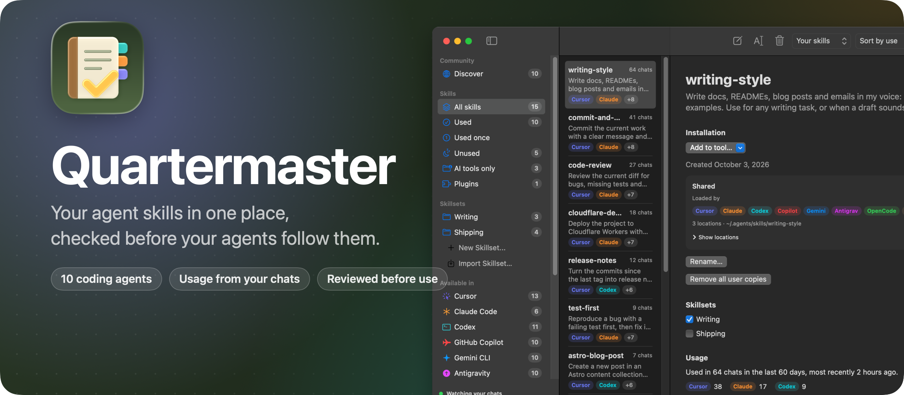
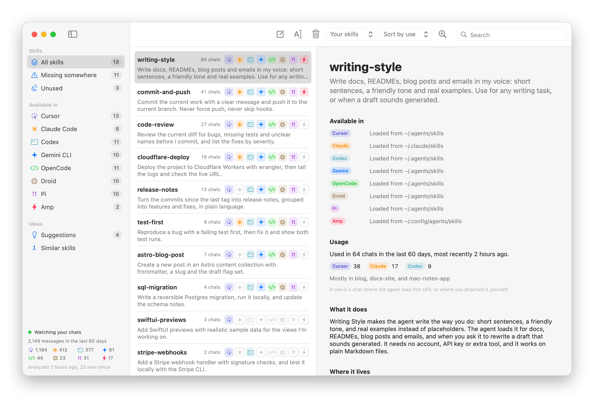
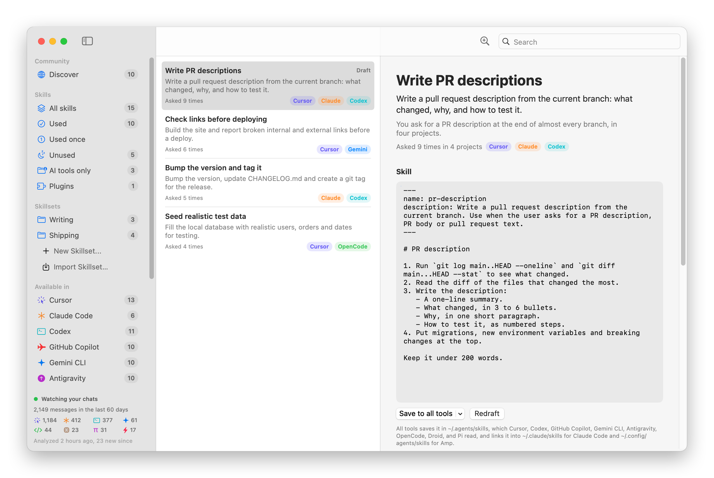

Quartermaster checks the skills your coding agents follow before they follow them. It finds every skill on your Mac, shows which agents load each one, counts how often you really use them from your chats, shows the scripts and commands a downloaded skill or plugin runs, and previews every repository update before it lands. Skills you keep come from a Library, grouped into skillsets you apply to each agent.

Quartermaster was called Skillscout Mod, and it's an independent fork of [Flavio Copes's Skillscout](https://github.com/flaviocopes/skillscout). Like the original, it finds your skills, maps which agents see them, and counts their use.

It knows 10 agents: Cursor, Claude Code, Codex, GitHub Copilot, Gemini CLI, Antigravity, OpenCode, Droid, Pi and Amp. Each one reads skills from its own folders, and some also read the folders of the others. So a skill you wrote for Claude Code can load in Cursor but not in Codex. Quartermaster maps all of it, and adds a skill to the agents that miss it with one click.

It also reads your chats. It counts a use every time an agent loads a skill, and it looks for requests you keep typing, so you can turn them into new skills.

Read [Design](DESIGN.md) for the workspace model and interaction rationale, [UI reference](UI.md) for the current screens and verification commands, or the [changelog](CHANGELOG.md) for changes since the latest release.

Read [Flavio's original announcement and watch his 1-minute demo](https://flaviocopes.com/skillscout/). The demo shows the original app; this fork has additional screens and workflows.

[](https://flaviocopes.com/skillscout/)

## What Quartermaster adds

Everything in the original stays: the agent map, usage counts, editing, renaming, merging similar skills and skill ideas. On top of that, Quartermaster adds:

- **[Discovery and Library](#discovery-and-library)**: browse curated skill repositories, or add your own Git repository or local folder, and download them into a Library in `~/.config/quartermaster/skills`. Then choose which skills each agent gets.
- **[Reviewing downloaded skills](#reviewing-downloaded-skills)**: a Contents section lists a downloaded skill's scripts and the commands worth reading, and Quartermaster asks before adding a flagged skill to an agent.
- **Update previews**: refreshing a Library repository shows the commit and every added, changed and removed file before anything is replaced.
- **[Skillsets](#skillsets)**: group skills into collections, assign them to agents with a preview of each change, and export or import them as JSON to move them to another Mac.
- **[Plugins](#plugins)**: a read-only view of the plugins installed in Claude Code, Codex and Cursor, with the hooks, MCP and language servers, monitors and executables they run without asking.
- **Problems**: each skill you can edit is checked against the [Agent Skills specification](https://agentskills.io/specification).
- **Batch add**: select one or more skills, choose tools and sources, inspect their contents, and review each result. Existing content stays until you explicitly replace it.
- **Scoped usage**: filter recorded skill use by project and period within the loaded chat history. The same scope applies to counts and sorting.
- **Saved ideas**: save an AI draft to the Library without installing it, or choose a tool destination. Open the saved skill, add it to a skillset, and see its actual availability and recorded use.
- **Keep or replace**: when an agent already has a different copy of a skill, choose which one stays. The old copy goes to the Trash.
- **More agents**: GitHub Copilot and Antigravity, for 10 in all.
- **Workspace management**: Library holds reusable sources and skillsets. Global manages home-level installations. Projects show available skills, including inherited Global skills, and default additions to the selected workspace. Agent chips filter availability.
- **Visible choices**: Tool and short filter choices use wrapping chips. Projects, skillsets, sources, files and versions use searchable panels with the current choice visible. Filter panels scroll in shorter windows so skill lists stay usable.
- **[More commands](#the-command-line-tool)**: `quartermaster skillset`, `plugins`, `install` and `update`, with a review before anything flagged is linked.

Quartermaster has its own app name, `quartermaster` command (and `qm`), data folder and update channel, so it can sit next to the original Skillscout.

### Coming from Skillscout Mod

Skillscout Mod can't update itself to Quartermaster, because the app has a new name and bundle ID. Download Quartermaster once, as below, then move Skillscout Mod to the Trash. On first launch Quartermaster:

- moves the Library from `~/.config/skillscout` to `~/.config/quartermaster`, leaves a link at the old path so older links and scripts still work, and points the agents' links at the new folder
- copies its data from `~/Library/Application Support/Skillscout Mod` and its settings from Skillscout Mod
- updates itself from then on

Choose **Install Command Line Tool…** again. The `skillscout-mod` link pointed into the old app, so it adds `quartermaster`, `qm` and a `skillscout-mod` link for old scripts. It leaves a `qm` that another program installed alone.

## Download

Download `Quartermaster-<version>.zip` from the latest of the [thawee/skillscout releases](https://github.com/thawee/skillscout/releases), unzip it, and move **Quartermaster** to your Applications folder. It runs on macOS 15 Sequoia or later, on Apple silicon and Intel Macs.

### Opening it the first time

Quartermaster isn't signed with an Apple Developer ID or notarized by Apple. So the first time you open it, macOS says it "could not verify Quartermaster is free of malware". Click **Done**, then allow it in one of two ways.

In System Settings, open **Privacy & Security** and scroll down to the message about Quartermaster. Click **Open Anyway**, confirm, and open the app again. The button shows up for about an hour after you try to open the app.

In Terminal, remove the quarantine flag macOS adds to downloaded files, then open the app:

```sh
xattr -dr com.apple.quarantine "/Applications/Quartermaster.app"
```

The same command fixes a message saying Quartermaster is damaged. You don't need to turn off Gatekeeper for either option.

On a work laptop you might not be able to install apps in `/Applications`. You can keep the app in the `Applications` folder inside your home folder, and run the command on `~/Applications/Quartermaster.app`. If your company blocks apps that aren't notarized, ask your IT team.

### Updates

Once a day, Quartermaster checks [this fork's releases](https://github.com/thawee/skillscout/releases) for a newer version. When there is one, **Install and Relaunch** puts it in place. **Quartermaster → Check for Updates…** checks right away. The `quartermaster` command lives inside the app, so it updates too.

To turn off the daily check, run this in Terminal:

```sh
defaults write com.thawee.quartermaster AppUpdaterAutomaticChecks -bool false
```

## Features

- Every skill from your agents in one list, with a row of icons showing which agents load it
- **Library** lists reusable central, draft and shared sources, including those also installed globally
- **Global** lists home-level installations readable by tools enabled in Settings, including personal skills outside Library and plugin or built-in skills. The sidebar's Global section lists **All agents**, **Shared** (`~/.agents/skills`, read by several agents), and **Agents**, which folds out to each enabled agent by name. **Shared** shows the skills in that folder, and **Remove from Shared…** moves a shared copy to the Trash after naming every agent it affects. Badges and new destination choices follow that enabled selection
- **Projects** list skills available in the selected workspace. **Available here** includes inherited Global skills; **Project only** shows project copies readable by the selected agent
- **Add skills…** chooses individual skills or a skillset and a destination. Global additions link or copy sources into agent folders; project additions make portable copies after a preview
- If an AI tool already has a different installation, **Keep existing** leaves it in place or **Replace with selected source** moves it to Trash and installs your chosen source, restoring the previous entry if installation fails
- **Uninstall** moves a skill to the Trash, from all your skills folders or from one of them
- **Skillsets** group skills into reusable collections, with explicit assignments to each agent and previews of changes
- Register workspace folders under **Projects** and use **Add skills…** to copy individual skills or a skillset into the selected project after a preview
- **Edit** changes a skill's `SKILL.md` right in the app, in every copy that has the same text
- **Rename** gives a skill a new name in its folders, its links and its `SKILL.md`, and keeps its usage
- **Similar skills** pairs the skills that read alike, and **Merge with AI** turns two of them into one
- **Chat activity** lists **Used in 2+ chats**, **Used in 1 chat** and **No recorded use** within the selected period and project. No recorded use describes chat history, regardless of installation
- Usage for each skill: how many chats, from which agents, in which projects, and when you last used it
- The skills you created last come first, and you can sort by name or by use instead
- Search by name or description with `⌘F`
- **Explain with AI** asks Claude Code or Codex what a skill does, when the agent uses it, and what it needs to work
- **Suggestions** finds the tasks you keep asking for and drafts a `SKILL.md` for each one
- **Plugins** lists the plugins installed in Claude Code, Codex and Cursor, with their skills and what they run on your Mac without asking: hooks, MCP and language servers, monitors and executables. It only reads them
- Plugin and built-in skills from Cursor, Claude Code and Codex, with visible filter choices above skill lists to show your skills, the plugin ones, the built-in ones, or all of them
- Every copy of a skill on disk, with a warning when two copies have different content
- **Problems** checks each skill you can edit against the [Agent Skills specification](https://agentskills.io/specification): a missing name or description, a name that breaks the naming rules or doesn't match its folder, a description over 1024 characters, or a `SKILL.md` over the recommended 500 lines. `quartermaster show` lists them too
- The list and the counts update while you work, as skills and chats change on disk
- A `quartermaster` command for your terminal that reads the same data
- Updates from inside the app: it checks GitHub once a day, and **Install and Relaunch** puts the new version in place
- Light and dark appearance following the macOS setting

## Discovery and Library

Discovery starts with seven curated repositories: Android skills, Anthropic skills, Matt Pocock's skills, UI/UX Pro Max, Addy Osmani's agent skills, the SwiftUI agent skill, and [Archify](https://github.com/tt-a1i/archify) for diagrams and one-page explainers. Search skills.sh or add your own source for anything else. These are browsing suggestions; nothing is downloaded until you choose **Load skills** or **Add to Library**.

Open **Discovery**, the second sidebar item, and choose **Git** (repositories), **Folders** (local folders) or **skills.sh** inside the screen. Browse curated, custom, and imported sources together. Select a source to see its details and searchable skill list. Imported sources stay visible even when no agent uses their skills.

Choose **Load skills** to inspect a temporary preview without adding anything to Library or an agent. **Add to Library** imports that exact snapshot into `~/.config/quartermaster/skills`. Open a skill and use **Add skills…**, or add it to a skillset, to make it available to agents. The skill detail stays tied to the selected repository when other repositories contain the same skill name.

Archify is listed as `https://github.com/tt-a1i/archify.git`. Use a repository URL when adding a Git source; a GitHub `/tree/` link points to a folder page and cannot be cloned. Default and named branch previews clone one commit, which avoids downloading a repository's full history. Tag and commit previews still clone the full history.

Use **Add source** to register a Git repository URL or local folder. Adding a local source to Library copies its files. **Refresh from Folder** reviews changes from the original folder before replacing that copy.

### skills.sh

Choose **skills.sh** in Discovery, type in the search field and press Return to look up the [skills.sh](https://skills.sh) directory, the one the `npx skills` command installs from. Under **Git**, **Search skills.sh** under a search does the same with its text. Results keep skills.sh's order, most relevant first, and show each skill's `owner/repo`, install count, and whether its repository is already **In Discovery** or **In Library**. Select a result to see its install count, links to its skills.sh page and repository, and the other results from the same repository. **Add Repository to Discovery** saves the GitHub repository as a custom source and opens it, searched for that skill, where **Load skills** and **Add to Library** work as for any other source; nothing is downloaded until you choose one of them, and **More actions** > **Remove from Discovery** takes the source away again. A result Discovery already lists shows **Show Repository** instead. Results that aren't GitHub repositories can't be added here. The last search and its results stay while you look at repositories, until you search again.

Skills that `npx skills` installed show **Installed with skills.sh from owner/repo** in their detail, from the CLI's lock files: `~/.agents/.skill-lock.json` for global skills and `skills-lock.json` in a project folder for project skills. The app reads `$XDG_STATE_HOME/skills/.skill-lock.json` instead only when it was started with that variable set, which an app opened from Finder isn't. **Show in Discovery** (or **Add to Discovery**, when Discovery doesn't list it yet) opens that repository, so you can add it to Library and check it for updates. Quartermaster only reads these files.

**Check for updates** compares an installed Git repository with its tracked branch. **Check all for updates** in the Discovery toolbar checks each installed Git source in turn without applying anything, shows its progress, then says how many have updates and switches to **Updates available** when any do. Local folders have no remote, so they aren't checked. An available update has a **Review update…** action. Failed checks remain visible and never imply that a repository is up to date.

**Choose version…** lets you track a branch or pin a tag or full commit. A tag pin records its resolved commit and stays there if the remote tag moves. A pinned source changes only when you choose another version. You can pin a full commit even when the repository has no tags. Private HTTPS sources can retry checks and reviewed updates with a temporary personal access token; the version picker also accepts one. Tokens are never saved in repository metadata.

Every update or version change compares the previous upstream version, your Library copy, and the incoming version. Unrelated local edits are preserved; non-overlapping text edits merge automatically. Conflicting files offer **Keep mine**, **Use GitHub** (or **Use incoming**), and **Merge** for supported text. The merge editor shows the three versions for reference. Older imports without a recoverable baseline require explicit choices when equality cannot establish a safe result.

Choose **Review choices** to inspect the actual resulting files, scripts, flagged commands, and installation impact, then **Apply update**. Back returns to decisions and discards that reviewed result. Existing agent links receive the approved Library contents at their current paths. Independent agent copies and project copies stay unchanged and require separate updates; modified project copies remain protected. New skills appear in Library without creating agent links or changing skillset membership. A new skill beneath an already linked parent folder can become visible to that folder's readers.

Updates that would break a linked skill, or whose current, incoming, or reviewed contents changed, are refused. The previous Library copy goes to Trash. A verified upstream archive supports later comparisons while keeping preserved local edits separate from the upstream baseline. The CLI retains its explicit `--replace-local-edits` option, which replaces the entire snapshot.

### Reviewing downloaded skills

Agents follow a skill's instructions and can run the scripts beside it, so skills from downloaded repositories show a **Contents** section listing their scripts and the lines worth reading: commands that download and run a script, decode hidden content, use `sudo`, or delete from the home or root folder, plus notes for `eval`, `chmod` and network downloads. **Add skills…** asks first when a downloaded skill has scripts or high-risk commands, and a skillset's **Apply…** preview marks those skills. The checks are a heuristic, so a skill without flags still deserves a look before you trust it. **Remove from Library…** moves the repository and links into it to the Trash after confirmation; independent copies stay. Adding a custom source to Discovery only saves its address or path until you choose **Add to Library**. The CLI's `quartermaster install` still links skills to enabled or supported tools by default, after listing any scripts or high-risk commands and asking first. When a repository holds several versions of one skill, it links a version only to the agents that version alone lists in `supported_tools`, and prints every link it skips.

## Project skills

Open **Projects** in the sidebar and choose **Register project…**. Select a workspace folder. Registration only reads its skills; it does not import them into Library. Projects with the same folder name remain separate, with their full paths shown. The inventory scans known skill roots at that registered folder. Register a nested workspace separately to inspect its own roots; ancestor and nested discovery rules differ between agents.

Choose an **Agent** to see which skills it can use in this project. **Available here** combines project copies with **Inherited from Global** skills; **Project only** narrows the list to project copies. A skill in both locations appears once with both badges. Each project remembers its filters during the window session. Chat counts follow the selected agent, period and enabled history settings. The availability filter does not distinguish the source used in a chat. Use **Manage in Global…** to manage inherited installations. Project files can be inspected and revealed in Finder.

Choose **Add skills…**, select individual skills or a skillset, and review the project destination and every affected agent. Project installation supports these groups:

| Target | Project folder | Tools that read it |
|---|---|---|
| Shared | `.agents/skills` | Codex, Cursor, GitHub Copilot, Gemini CLI, Antigravity, OpenCode, Droid, Pi and Amp |
| Claude | `.claude/skills` | Claude Code, Cursor, GitHub Copilot, OpenCode and Amp |

The inventory also reads `.cursor/skills`, `.codex/skills` for Cursor interoperability, `.github/skills`, `.gemini/skills`, `.agent/skills`, `.opencode/skills`, `.factory/skills` and `.pi/skills`. An agent may require workspace trust or have its own precedence rules before loading these files.

The preview shows additions, updates, removals, kept files and conflicts, with source contents to review. Applying copies supporting files as well as `SKILL.md`. Copies do not depend on global symlinks; embedded links must be relative and stay inside the skill tree. Existing identical copies remain unowned. Different preexisting files block application, and changed app-owned files are preserved. Project-folder replacement, symlinked destination ancestors and a changed preview also stop application.

Individual additions are tracked separately from skillset templates and survive restart. **Remove from project…** previews removal from the selected project group, including its assignment snapshots. Global sources and central skillset membership stay unchanged. Modified or unowned project files remain with an explanation. Assignments retain the membership that was applied. Editing or deleting a shared skillset never silently changes project files; update or unassign it through a new preview. Overlapping assignments share their members. Unassigning moves only unchanged app-owned copies that no remaining assignment needs to Trash. **Forget project…** preserves all files and stops tracking the folder; finish recovery of an interrupted operation first.

Project chat counts match recorded working-directory paths and the selected period and enabled tools. Nested registered projects take precedence over their parents. History that supplies only a project name is excluded from these exact counts; no matching by folder name is attempted. Registration and assignment state survive app restart, and watched skill folders refresh after external changes. Project management is available in the app; the CLI continues to manage global skills and skillsets.

## Skillsets

Create a skillset in the sidebar, then use **Edit…** to select its members from the library and sources. Use **Manage…** to review and change its tool assignments. You can also select multiple skills in a list, right-click, and choose **Add to skillset**. In a skillset list, **Remove from this skillset** or Delete changes membership; it doesn't uninstall the skill.

If multiple repositories provide a skill with the same name, choose its source when adding it to a tool or in the skillset editor. Quartermaster saves that choice and shows all repository copies in the skill's Installation section.

Copies of a skill with different content are versions, such as a Claude Code version and a generic one. Agents read each other's folders (Cursor also reads `~/.claude/skills` and `~/.codex/skills`), so Quartermaster never leaves an agent reading two versions of a skill. When a member has versions, the **Apply…** preview offers **Choose versions…**: each version is titled by the agents it's meant for or the folders that tell it apart, and each enabled agent gets a row, prefilled from each version's `supported_tools`, the folder it sits in, or where it's installed. An agent that reads another agent's skills folder gets that agent's version, shown as "Same as Claude Code". **Skip** leaves an agent without the skill, so applying a skillset reports it as skipped, and **Decide later** (or **Preferred source**, when the skill has one) leaves the choice open. Save stays off while a choice would give any agent two versions. Applying leaves out an addition that would, naming the agent and the folder. Conflicts that already exist don't block other skills, and **Show conflicting copies** opens them in Finder, since only changing those copies fixes them. **Add skills…** refuses an add that would give an agent two versions too. In the command line, `quartermaster skillset version <skill>` lists the versions and the one each agent gets, and `--to <tool> --use <number|none|skip>` saves one.

Choose **Apply…** for an agent to preview additions, existing installations, removals and conflicts. A skillset can be assigned to several agents, and several skillsets can be assigned to one agent. Shared members stay installed until no assigned skillset needs them. Editing membership shows **Changes pending**; choose **Apply changes…** to update that agent. Missing sources and failed changes remain visible and can be retried.

**Unassign…** in a management row's action menu removes only unchanged links or copies that Quartermaster created for skillsets and that no remaining assignment needs. Personal installations and modified copies stay. Agents can still read skills from shared folders or other agents' folders, so **Not assigned** can coexist with available skills; the assignment row explains inherited sources. Existing skillsets migrate as unassigned collections, without claiming ownership of previous installations.

Right-click a skillset and choose **Export Skillset…** to save it as JSON, with the Git repository each Library skill came from. Skills from local folders are listed without a source, since their paths don't carry over to another Mac. **Import Skillset…** under the skillsets adds one from a file, unassigned, under a new name if the name is taken, and lists the skills this Mac doesn't have yet with the sources to add in Discovery. Importing never downloads anything.

<picture>
  <source media="(prefers-color-scheme: dark)" srcset="docs/screenshot-dark.png" />
  
</picture>

The skills and chats in the screenshots are made up.

## Plugins

**Plugins** in the sidebar lists the plugins installed in Claude Code, Codex and Cursor. Each one shows its agent, marketplace, version and folder, whether it's on (Claude Code only), its skills, and what it runs on your Mac without asking each time: hooks, MCP servers, language servers, monitors and the executables it puts on the agent's `PATH`. Commands are shown, but environment values and credentials in URLs never are.

Quartermaster only reads plugins. Install, update or turn them off in the agent. `quartermaster plugins` prints the same list, and `--json` gives JSON.

## The agents it knows

Every agent has its own skills folder, and its own place for chats:

| Agent | Skills folder | Chats |
| --- | --- | --- |
| Cursor | `~/.cursor/skills` | `~/.cursor/projects/*/agent-transcripts` |
| Claude Code | `~/.claude/skills` | `~/.claude/projects` and `~/.claude/history.jsonl` |
| Codex | `~/.codex/skills` | `~/.codex/sessions` and `~/.codex/archived_sessions` |
| GitHub Copilot | `~/.copilot/skills` | - |
| Gemini CLI | `~/.gemini/skills` | `~/.gemini/tmp/*/chats` |
| Antigravity | `~/.gemini/antigravity/skills` | - |
| OpenCode | `~/.config/opencode/skills` | `~/.local/share/opencode/opencode.db` |
| Droid | `~/.factory/skills` | `~/.factory/sessions` |
| Pi | `~/.pi/agent/skills` | `~/.pi/agent/sessions` |
| Amp | `~/.config/agents/skills` | `~/.local/share/amp/threads` |

Some folders are read by more than one agent. `~/.agents/skills` is a shared folder that Cursor, Codex, Gemini CLI, OpenCode, Droid and Pi all load. Cursor and OpenCode also load `~/.claude/skills`, and Cursor loads `~/.codex/skills` too. Claude Code and Amp only read their own folders.

Quartermaster knows these rules, so for every skill it tells you which agents load it and from which folder.

Open **Library** to browse reusable sources, or **Global** to inspect installed personal, plugin and built-in skills. Plugin skills come from `~/.cursor/plugins`, `~/.claude/plugins/cache` and `~/.codex/plugins/cache`; Cursor and Codex also provide built-in skills.

Quartermaster enables chat history for the agents it finds on your Mac. Turning an agent off in Settings excludes its chats from counts. Global and project availability remain visible independently of those history settings.

## Adding a skill to more agents

Pick a skill, and the **Installation** section shows its library source and which agents load each copy. Use **Add skills…** to make it available to another agent.

Adding a skill creates a symbolic link to the skill folder inside that agent's skills folder. The agents all load the same `SKILL.md`, so when you edit it, every one of them gets the change.

Plugin skills get copied instead of linked, because a plugin update replaces its folders.

## Removing a skill

Pick a skill and use **Remove from tool…** beside its tool in **Installation**. When viewing a tool's skill list, its right-click action, the toolbar's Trash button and Delete use that tool. You can select several skills to remove them together. In Global with **All agents** selected, choose the agent from the removal menu; with **Shared** selected, **Remove from Shared…** removes the copy in `~/.agents/skills`. Library source removal remains separate from installation removal. Delete in a skillset only removes membership.

Right-click actions follow the selected destination. Library offers catalog actions and **Add skills…**. Global offers installation management for the selected agent, with affected-agent previews for shared folders. Global usage counts cover all loaded history; use Dashboard project and period filters for usage analysis. Personal installations outside Library can offer **Move to Library** when the source can safely move: a real folder in an agent's skills folder moves into Library, identical copies in other agent folders go to the Trash, and every agent folder gets a link. A skill that only links to a folder elsewhere stays where it is. If a step fails, the earlier steps are undone. A skill you moved into Library stays editable; skills from a Library repository stay as downloaded. A skillset offers **Remove from this skillset**, which changes template membership rather than uninstalling copies. Protected skills retain Finder actions and hide unsupported edits or moves.

Some agents read the same installations, including folders owned by other agents. Those actions say **Remove shared installation…** and group enabled tools with the same removal plan. Review also discloses effects on readers disabled in Settings. Disabling a tool changes normal visibility and choices; it does not uninstall skills or remove assignments. Re-enable a tool to manage its retained assignments. Independent installations stay. When removing a physical folder, links to that folder go too, since they'd point to nothing. When removing a link, its Library source stays.

**Show locations** lists paths and Finder links. **Remove everywhere…** is under **More removal options**; Library sources also have **Remove source…** in their source menu. Quartermaster moves selected folders and links to the Trash, so you can restore them. The confirmation explains which agents lose access and which can still load a remaining copy.

Plugin and built-in skills stay where they are. Their agents manage them, so uninstall the plugin to remove its skills.

## Editing a skill

Select a skill and click the edit button in the toolbar, or **Edit** above its `SKILL.md`. The editor keeps your quotes straight and your `--` as two hyphens, so the commands in a skill still run.

Quartermaster saves the text to every copy of the skill that had the same text. A copy with different text stays as it is, and so does a plugin copy. If an agent changes the `SKILL.md` while you're editing it, Quartermaster tells you before it saves over that change.

The name in the frontmatter stays as it is, since a new name also means new folders. Use **Rename** for that. **Open in editor** opens the file in your usual Markdown editor instead.

## Renaming a skill

Select a skill and click the rename button in the toolbar, or **Rename…** under **Where it lives**. Names use lowercase letters, numbers and hyphens, like `release-notes`.

Quartermaster renames the skill's folders in your skills folders, creates its links again under the new name, and changes the `name` in its `SKILL.md`. A folder outside your skills folders, like a repo of skills your links point to, keeps its folder name. A plugin copy keeps the old name too.

Chats that used the old name keep counting for the skill.

Skillset memberships, applied assignments and ownership records follow the new name, so unassigning still removes only Quartermaster's unchanged installations.

## Merging similar skills

After a while, you end up with two skills that do almost the same job. **Similar skills** in the sidebar lists the pairs that read alike, and the words they share.

Quartermaster compares the words in each skill's name, description and `SKILL.md`, and rare words count more than common ones. It runs on your Mac, without AI, and it only pairs your own skills, not plugin or built-in ones.

Pick a pair to see the two skills side by side. Choose the name to keep and click **Merge with AI**. Claude Code or Codex writes one `SKILL.md` from both, and you can edit it before anything changes. When you click **Merge into**, Quartermaster:

- writes the new `SKILL.md` into the kept skill's folder, and moves the old one to the Trash
- copies over the other skill's extra files, like templates and references, unless the kept skill has one at the same path
- moves the other skill to the Trash
- links the kept skill into the other one's folders, so the agents that loaded the other skill load the kept one

Chats that used the other skill count for the kept one from then on.

Skillsets replace the merged skill with the kept one. If a skillset contained both, it keeps one member.

If two skills look alike but do different jobs, click **They're different skills**, and Quartermaster won't pair them again.

## Counting uses

A use is a chat where the agent read the skill, or where you attached it yourself.

Quartermaster looks for the moment an agent opens a skill's `SKILL.md`. That can be a skill tool call, a file read, or a shell command that prints the file. It also counts the skills you attach in Cursor and the slash commands you run in Claude Code. A chat counts once per skill, however many times the agent reads it.

It reads the last 60 days of chats. You can change that to 30, 90 or 180 days in Settings.

## Skill ideas

Some requests you type again and again, like "check the links before deploying" or "bump the version and tag it". Each one could be a skill.

Open **Suggestions** and click **Find repeated tasks** in its toolbar. Quartermaster sends your 2,000 most recent messages to Claude Code or Codex. It asks for requests you keep making that a skill could handle, and skips the ones your skills already cover. Each idea shows how many times you asked, in which projects, and the messages that match.

<picture>
  <source media="(prefers-color-scheme: dark)" srcset="docs/screenshot-suggestions-dark.png" />
  
</picture>

Click **Draft the skill with AI** to get a `SKILL.md` you can edit right there. **Save to all tools** writes it to `~/.agents/skills` and links it into `~/.claude/skills` and `~/.config/agents/skills`, so all 10 agents load it. The menu next to it saves the skill for a single agent. **Dismiss this idea** hides it, and later runs won't suggest it again.

After your first run, Quartermaster analyzes again on its own once you've sent 40 new messages, at most every 30 minutes. You can change the number, or turn it off, in Settings.

## The command line tool

Quartermaster comes with a `quartermaster` command, and `qm` for short. To install them, open the app menu and choose **Install Command Line Tool…**. It links the command inside the app into `/usr/local/bin` as `quartermaster`, `qm` and `skillscout-mod`, the old name, and asks for your password if that folder needs it. A `qm` or `skillscout-mod` that belongs to another program stays as it is.

The command reads the same skills and chats as the app, and follows its settings, like which agents are on and how many days of chats to read.

| Command | What it does |
| --- | --- |
| `quartermaster list` | Lists your skills and the agents that load them |
| `quartermaster show <skill>` | Where a skill lives, which agents see it, and its usage |
| `quartermaster usage` | Ranks skills by how many chats used them |
| `quartermaster tools` | The agents Quartermaster knows, and where each one keeps its skills |
| `quartermaster similar` | Lists the pairs of skills that read alike |
| `quartermaster add <skill> --to <tool>` | Adds a skill to another agent |
| `quartermaster install <url_or_path>` | Adds a repository or local skill to the managed Library |
| `quartermaster update <skill-or-repository>` | Reviews repository changes and applies them after confirmation |
| `quartermaster update <repository> --check` | Checks the installed ref without applying an update |
| `quartermaster update --all --check` | Checks all installed Git repositories |
| `quartermaster update <repository> --tag <name>` | Reviews switching to a pinned tag |
| `quartermaster rename <skill> <new-name>` | Gives a skill a new name |
| `quartermaster merge <skill> <other>` | Merges the other skill into the first one with AI |
| `quartermaster uninstall <skill>` | Moves a skill to the Trash |
| `quartermaster suggest` | Asks AI for skill ideas based on requests you repeat |
| `quartermaster explain <skill>` | Asks AI what a skill does |
| `quartermaster skillset <action>` | Lists, shows, applies, unassigns, exports and imports skillsets |
| `quartermaster plugins` | Lists the plugins in your agents and what they run |

Run `quartermaster` alone for a summary, and `quartermaster help <command>` for the options of each command.

`list` shows a column for each agent. A dot means that agent can't see the skill:

```sh
quartermaster list
```

```
SKILL              CHATS  Cu Cl Co Ge Op Dr Pi Am DESCRIPTION
astro-blog-post        7  ●  ·  ●  ●  ●  ●  ●  ·  Create a new post in an Astro content collection …
cloudflare-deploy     18  ●  ●  ●  ●  ●  ●  ●  ·  Deploy the project to Cloudflare Workers with wra…
code-review           27  ●  ●  ●  ●  ●  ●  ●  ·  Review the current diff for bugs, missing tests a…
commit-and-push       41  ●  ●  ●  ●  ●  ●  ●  ●  Commit the current work with a clear message and …
pdf-invoices           –  ●  ●  ·  ·  ●  ·  ·  ·  Generate PDF invoices from a JSON order, with the…
```

Add `--missing` to see only the skills some agent can't load, `--unused` for the ones no chat used, or `--tool claude` for the skills one agent loads. `--sort use` puts your most used skills first, and `--sort newest` the ones you created last.

`show` tells you what's missing and prints the command that fixes it:

```sh
quartermaster show release-notes
```

```
release-notes
Turn the commits since the last tag into release notes, grouped into features and fixes, in plain
language.

Available in
  ● Cursor       ~/.agents/skills
  · Claude Code  missing  quartermaster add release-notes --to claude
  ● Codex        ~/.agents/skills
  ● Gemini CLI   ~/.agents/skills
  ● OpenCode     ~/.agents/skills
  ● Droid        ~/.agents/skills
  ● Pi           ~/.agents/skills
  · Amp          missing  quartermaster add release-notes --to amp
```

`usage` ranks your skills, with the chats from each agent:

```sh
quartermaster usage
```

```
SKILL              CHATS  LAST USED    TOOLS
writing-style         64  2 hours ago  Cursor 38, Claude Code 17, Codex 9
commit-and-push       41  5 hours ago  Cursor 22, Claude Code 11, Codex 5, Amp 3
code-review           27  1 day ago    Cursor 9, Claude Code 14, OpenCode 4
cloudflare-deploy     18  2 days ago   Cursor 7, Codex 11
release-notes         12  4 days ago   Cursor 8, Gemini CLI 4
```

`add` works like the button in the app. Pass `--to` with one agent, or `--all` for every agent you use that's missing the skill:

```sh
quartermaster add release-notes --all
```

If the skill comes from a Library repository and has scripts or high-risk commands, `add` lists them and asks before linking it. Pass `--yes` to skip the question; without a terminal, `add` stops instead of waiting for an answer. `update` works the same way: it lists the added, changed and removed files and the flagged lines, and replaces the Library copy only after you confirm or pass `--yes`.

`skillset` works with the skillsets you make in the app. `apply` and `unassign` preview the changes like the app does and ask first, and `export` and `import` move a skillset to another Mac. Pass `--no-link` to `install` to add an imported skillset's repositories to the Library without linking every skill:

```sh
quartermaster skillset list
quartermaster skillset apply Engineer --to claude
quartermaster skillset export Engineer --output engineer.json
quartermaster skillset import engineer.json
quartermaster install https://github.com/example/skills --no-link
```

`apply`, `unassign`, `import`, `rename` and `merge` change the app's saved state, so they stop while Quartermaster is open. Quit the app first, and it picks up the change the next time it opens.

`uninstall` moves every copy of a skill to the Trash. Pass `--from` with one agent to remove only the copy in that agent's skills folder, which undoes an `add`:

```sh
quartermaster uninstall release-notes --from amp
```

`rename` takes the skill and its new name:

```sh
quartermaster rename release-notes changelog
```

`similar` lists the same pairs as the app, without the ones you dismissed there:

```sh
quartermaster similar
```

```
SKILLS                       ALIKE  BOTH MENTION
email-style + writing-style    34%  tone, short, sentences, friendly
```

`merge` keeps the first skill and merges the other one into it. Add `--dry-run` to read the merged `SKILL.md` before anything changes:

```sh
quartermaster merge writing-style email-style --dry-run
```

`suggest`, `explain` and `merge` take `--engine codex` or `--engine claude`, and `--model` to pick the model. `explain` returns the app's saved explanation when there is one, and `--fresh` asks again.

Most commands take `--json`, so you can use Quartermaster from scripts:

```sh
quartermaster list --unused --json
```

## Dashboard

**Dashboard** is the first sidebar item and opens when you launch the app. It summarizes recorded skill use by period, enabled tool and project. It counts distinct chats containing recognized skills, shows last use, and lists skills with no recorded use in the selected period. Dashboard filters are independent of the skill lists. History is limited to the loaded lookback window and retained chats may be incomplete.

Library review shows similar skills, differing copies, and the bytes and lines in each unique source's `SKILL.md`. Local review findings flag scripts and commands worth inspecting. Dashboard makes no AI calls. Instruction size does not measure actual token consumption, findings do not prove safety, and usage counts do not measure output quality.

## Privacy

Quartermaster reads your skill folders, your agents' plugin folders and your chats on your Mac, and has no accounts or analytics. It shows the commands plugins run but never their environment values. The only request it makes on its own goes to GitHub: once a day, it asks whether there's a newer version of Quartermaster, and it downloads one only when you click **Install and Relaunch**.

Discovery reads a registry bundled with the app. A skills.sh search sends the search text to `skills.sh/api/search`, only when you press Return in the **skills.sh** search or click **Search**, **Search skills.sh** or **Try again**; typing alone sends nothing, and the app never contacts skills.sh otherwise. That endpoint is the one the `npx skills find` command uses, and skills.sh doesn't document it, so it may stop working. Loading a skill preview, adding a repository to Library, checking branches or tags for updates, listing versions, and applying a version run Git against the sources you select. Check all checks the installed Git sources; commit pins stay fixed without contacting their hosts. These actions are user initiated and contact repository hosts without sending your chats. Temporary previews stay outside Library and create no agent links. Branch, tag, and commit options are also available on the CLI's install and update commands.

Your chats leave your Mac only through the AI features. **Explain with AI**, **Find repeated tasks**, **Draft the skill with AI** and **Merge with AI** run the Codex CLI or the Claude Code CLI you're already logged in to, so the prompt goes to OpenAI or Anthropic under your own account. To find skill ideas, that prompt includes up to 2,000 of your recent messages, each cut to 220 characters, with the agent and project it came from. To merge two skills, it includes both `SKILL.md` files and the names of their other files.

Quartermaster runs Codex with `--ephemeral` in a read-only sandbox, and Claude Code with `--no-session-persistence` and no tools. These runs don't show up in your chat history.

Quartermaster keeps its own data in `~/Library/Application Support/Quartermaster`. On first launch it copies data from the `Skillscout Mod` folder, or from the older `Skillscout Thawee` or original `Skillscout` folder. The folder contains a cache of parsed chats, saved explanations, ideas and drafts, and old skill names used to count earlier chats.

## Build it from source

You need macOS 15 or later and Xcode 26. The app icon is an Icon Composer file, and older Xcode versions can't build it.

Open `Skillscout.xcodeproj` and press `⌘R`. To build the release zip from the terminal, run:

```sh
scripts/build-release.sh
```

It builds a universal app in `build/release/Release/Quartermaster.app`, checks its signature, and zips it into `dist/`. The app is ad-hoc signed. A copy you build yourself opens without a warning.

The `quartermaster` command is its own target, `SkillscoutCLI`, and the app embeds it in `Contents/Helpers`. To build only the command:

```sh
xcodebuild -project Skillscout.xcodeproj -target SkillscoutCLI -configuration Release build
```

## Development

The Xcode project is generated from `project.yml` with [XcodeGen](https://github.com/yonaskolb/XcodeGen). After editing `project.yml`, regenerate it:

```sh
xcodegen generate
```

The command line tool shares the app's core files: the models, the skill scanner, the chat readers, the installer, the similarity check and the AI engine. Its own code lives in `CLI/`.

Unit tests for the core files live in `Tests/`, and a functional check runs the app's workflows and renders its views against a made-up home folder:

```sh
xcodebuild test -scheme SkillscoutTests
python3 scripts/functional-check.py
python3 scripts/functional-check.py --projects
```

The app icon is drawn in code. Edit `scripts/render-icon.swift`, then write a new `Skillscout/AppIcon.icon`:

```sh
swift scripts/render-icon.swift
```

The screenshots come from the real app views, with made-up skills, chats, skillsets, a Library repository and a plugin in a demo home folder. The capture app has its own bundle ID, so your settings and skills stay as they are. It renders the earlier macOS design, because the capture can't draw macOS 26's Liquid Glass sidebar and toolbar:

```sh
scripts/screenshot.sh
```

The banner uses the icon and the dark screenshot:

```sh
swift scripts/render-banner.swift
```

To publish a release, set `MARKETING_VERSION` and bump `CURRENT_PROJECT_VERSION` in `project.yml`, write the notes in `docs/releases/vX.Y.Z.md` with the new features above `## Install`, commit, and push the tag:

```sh
git tag -a v2.0.0 -m "Quartermaster 2.0.0"
git push origin v2.0.0
```

The Release workflow checks that the tag matches the version, runs the unit tests, builds the universal zip and publishes the GitHub release with it. To publish a tag that was pushed before the workflow existed, run the workflow from the Actions tab with that tag.

Working with an AI coding agent? Point it at [AGENTS.md](AGENTS.md). It has the commands and the rules to follow.

## How it works

At launch Quartermaster scans every skills folder it knows. A skill is a folder with a `SKILL.md` file, and the name and description come from its frontmatter. When the same skill shows up in more than one folder, through a link or a copy, Quartermaster groups the copies under one name and follows each agent's rules to work out which agents load it.

Then it reads the chats of every agent you turned on. Each agent stores them differently. Cursor, Claude Code, Codex, Droid and Pi write JSONL files, Gemini CLI and Amp write JSON, and OpenCode keeps a SQLite database. Quartermaster keeps the messages you typed and the moments an agent loaded a skill, and caches what it parsed. On the next launch it only reads the files whose size or date changed.

It also reads the plugin folders of Claude Code, Codex and Cursor, and the Library in `~/.config/quartermaster/skills`, which agents only see through the links Quartermaster makes.

An FSEvents watcher on the agents' folders refreshes the list and the counts while you work.

## License

Quartermaster is a fork of [Skillscout](https://github.com/flaviocopes/skillscout) by Flavio Copes, and keeps its [MIT license](LICENSE) and copyright notice. It's provided as is, without warranty of any kind. The fork isn't endorsed by Flavio Copes; report its problems at [thawee/skillscout](https://github.com/thawee/skillscout).

Quartermaster is an independent project, and it isn't affiliated with the makers of the agents it works with. Cursor, Claude Code, Codex, GitHub Copilot, Gemini CLI, Antigravity, OpenCode, Droid, Pi and Amp are trademarks of their owners.
